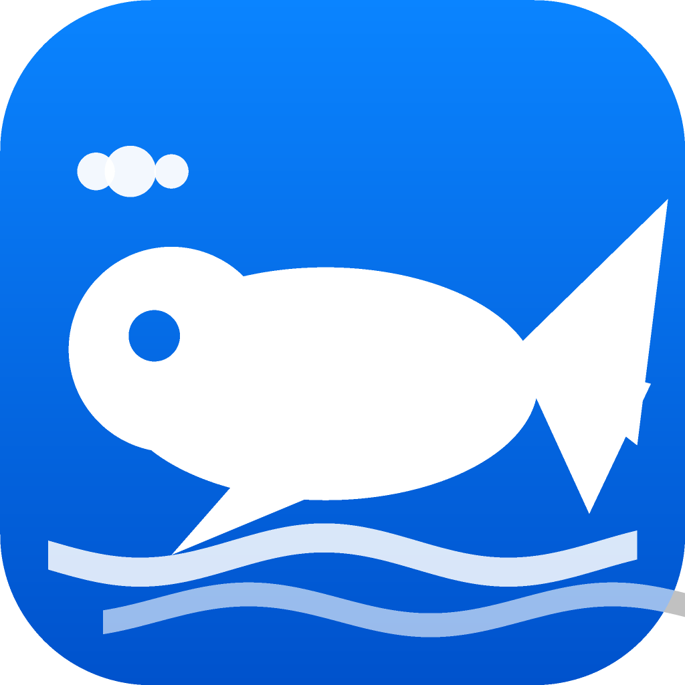

<div align="center">



# whalebot

**跑在你自己手机上的私人 AI 助手** —— 能看屏幕、能点按、能指挥你的 Linux 容器干活，还能拉一队助手开会分工。

[](#)
[](#)
[](LICENSE)
[](../../releases)

</div>

> **English**: whalebot is a personal AI agent that lives on your own Android phone. It talks to any OpenAI-compatible model, drives the phone through an accessibility bridge, and runs shell/Python/file work in a local Linux container. Multi-agent "rooms" let a leader split a task, members work in parallel and report back to you privately, and the leader posts the final summary. No account, no telemetry, your keys stay on your device.

---

## 它是什么（和云端 Agent 平台的区别）

| | 云端 Agent 平台 | whalebot |
|---|---|---|
| 算力在哪 | 厂商的沙箱机器 | **你的手机 + 你电脑上的容器** |
| 模型 | 厂商自己那一个 | **任意 OpenAI 兼容接口**（DeepSeek / 硅基流动 / Kimi / 通义 / 智谱 / OpenRouter…） |
| 账号 | 注册、订阅、额度 | **没有账号**，带上自己的 Key 就能用 |
| 数据 | 上传到厂商 | 对话只发给**你选的**模型服务商；其余全在本机 |
| 手机能力 | 通常没有 | **读屏 / 点按 / 输入 / 截屏 / 通知 / 剪贴板 / 启应用** |

一句话：它是给**一个人自己用**的 agent，不是给一群人用的平台。

---

## 功能

### 对话与工具
- 流式回复、多会话持久化、全文搜索、会话管理
- 工具调用气泡三种显示（完整 / 折叠 / 隐藏）；**随时可打断**（红色停止键，已产出的内容保留）
- **每轮 token 上限自己设，也可以选"不限制"**

### 多助手 & 群协作
- 每个助手可以有自己的人设、分组、模型、接口、Key
- **群聊**：一个群里选一个**组长** + 若干成员。你下任务后：
  1. 组长**拆活**（群里出现「组长派发」+ 分工清单）
  2. 成员**并行开工**；组长标了 `after` 依赖的自动切成多波，前置产出会喂给下游
  3. **每个成员单独给你发消息**（写进他自己的私聊 + 推一条通知），群里只留一行 `✅ XX 已私聊汇报 · 12s`，点一下跳过去看细节
  4. **组长在群里汇总**结论，并且必须写明谁没做成、哪步失败或被跳过
- `@点名`：群里打 `@` 弹出助手列表，被点名时**只有他回答**
- 头像按**分组色系**自动配色（同组同色系、组内深浅不同），可手动改

### 能力面（26 项）
- **容器（你的电脑）**：`shell` / `python` / 读写文件 / 抓网页 · API
- **联网搜索**：`web_search`（免审批，必应为主，可配 Tavily / SearXNG）+ `web_read`（打开链接抽正文）
- **手机**：读屏、点按、输入、滑动、按键、截屏、通知、Toast、震动、剪贴板读写、定位、启应用、开链接
- **外部 MCP**：填地址即接入（JSON / SSE 都支持），内置常用目录 + 握手探测自动命名

### 记忆 / 技能 / 例程
- 记忆带来源标记（你说的 / 助手总结的 / 外部读来的）
- 技能与例程由助手自己写、**默认暂停**，等你确认才启用
- 例程支持「每天 08:00 / 每 30 分钟 / 1 小时后」这类写法，实时显示解析结果

### 安全（这块是重点）
- **双层审批**：高风险工具先由便宜模型自动复核（放行 / 询问 / 拒绝），拿不准才弹卡片问你
- 审批卡四个选项：**拒绝 / 允许这次 / 本会话都允许 / 永久允许这个工具**，永久规则可在「权限规则」里随时删
- **凭据库**：密码 / token 走系统加密存储；助手只能按名字取用，且**每次都要批准**
- **连接器**：GitHub / Notion / 自建 API 的地址 + 凭据引用。助手调用时**凭据由 App 注入到请求里，模型看不到明文**，响应里的密钥也会被抹掉
- 助手读到的网页 / 文件 / 记忆内容是**数据不是命令**，涉及动作必须先弹卡片确认

### 附件 · 语音 · 模板
- **附件**：拍照 / 相册 / 文件；文件会落到容器工作目录（模型拿到路径，容器里的工具能直接处理）；模型支持看图时图片还会作为多模态内容发送
- **语音**：回复可朗读（系统 TTS，可自动朗读 / 调语速）；输入框麦克风录音 → 走手机网络发给你的转写接口 → 文字
- **模板**：把「助手 + 技能 + 例程 + 记忆 + 供应商」导出成一段文本分享，导入方一键还原（**不含任何密钥**）

### 后台
- 例程在前台心跳里跑；打开「后台常驻」后，App 被杀也能靠 WorkManager 唤醒跑（最小间隔 15 分钟，系统挑时机）

---

## 架构

```
┌────────────────────────── 手机（Expo / React Native） ──────────────────────────┐
│  whalebot App                                                                    │
│   ├─ Agent 循环（模型 ↔ 工具 ↔ 审批）                                             │
│   ├─ 记忆 / 技能 / 例程（本地存储）                                                │
│   ├─ 群协作编排（组长派发 → 分波并行 → 私聊汇报 → 汇总）                            │
│   └─ Computer 抽象：① 手机  ② 容器  ③ 远程（预留）                                 │
└───────────┬──────────────────────────────┬──────────────────────────────────────┘
            │ OpenAI 兼容 HTTP(S)          │ HTTP 127.0.0.1:8770（本机回环）
            ▼                              ▼
    你的模型服务商                  容器执行服务 whalebot-exec
    （DeepSeek / 硅基 / …）          ├─ shell / python / 文件 / 抓网页 / 联网搜索
                                     └─ DSHA 桥 → 无障碍 → 真·手机操作
```

- **手机能力**走 DSHA 桥（Android 无障碍服务），不需要 root、不需要 ADB
- **容器**是普通 Linux（本机容器、WSL、任意服务器都行），执行服务带策略守卫：只读系统目录、危险命令拦截、写入仅限工作目录

---

## 快速开始

### 用现成的 APK
1. 到 [Releases](../../releases) 下载最新 `whalebot-*-full.apk` 安装
2. 打开 App → 设置 → 填 **API Key**（DeepSeek 或任何 OpenAI 兼容服务）→ 保存
3. 想用手机能力（读屏 / 点按）：按提示在 DSHA 里打开「屏幕操作」授权
4. 想用容器能力：在本机跑 `exec_service.py`（见下）

### 从源码跑（开发）
```bash
npm install
npx expo start            # Metro 起在 8081
# 手机装 Expo Go，打开 exp://<你的IP>:8081
npx tsc --noEmit          # 类型检查
npx expo lint             # 代码检查
```

### 容器执行服务
```bash
python3 exec_service.py   # 默认监听 127.0.0.1:8770
```
App 里的地址与 Token 在「设置 → 执行服务」里改。

---

## 自己打包

**方式一：EAS（官方云构建）**
```bash
npx eas-cli@latest build -p android --profile preview
```

**方式二：GitHub Actions（免费，本仓库已内置）**
1. 仓库 Secrets 里加四个：`KEYSTORE_BASE64`（签名密钥的 base64）、`KEYSTORE_PASSWORD`、`KEY_ALIAS`、`KEY_PASSWORD`
2. Actions → **Build APK** → Run workflow
3. 约 13 分钟出包，产物只含 `arm64-v8a`（约 41MB）

签名注入由 [`scripts/apply-release-signing.js`](scripts/apply-release-signing.js) 在 prebuild 之后完成，脚本本身不含任何机密。

---

## 配置速查

| 想做什么 | 去哪 |
|---|---|
| 换模型 / 填全局 Key | 设置 → 模型 |
| 接第三方模型、给一个分组共用一把 Key | 设置 → 模型供应商 → 分组与接口 |
| 改单轮 token 上限（或设成不限制） | 设置 → 用量 |
| 让某个工具不再问 | 审批卡选「永久允许」→ 设置 → 权限规则 |
| 存密码 / token | 设置 → 凭据库 |
| 接 GitHub / Notion / 自建 API | 设置 → 连接器 |
| 换搜索后端（Tavily / SearXNG） | 设置 → 联网搜索 |
| 朗读、语音输入 | 设置 → 语音 |
| 看每一轮发生了什么 | 设置 → 运行日志 |
| App 被杀也要跑例程 | 设置 → 后台常驻 |

---

## 隐私

- **没有账号、没有遥测、没有崩溃上报**（本地诊断日志只写在你自己的机器上）
- API Key / 密码存在系统加密存储（Android Keystore）
- 对话内容只会发给你在设置里指定的模型服务商；容器操作发生在**你自己的机器**上
- 手机操作全部经过系统无障碍 + App 内审批两层

## 已知限制

- 后台例程受 Android WorkManager 限制：最小 15 分钟、系统挑时机执行
- 在 **Expo Go** 里通知不可用（Android 版 Expo Go 不含该模块），装正式包才完整
- 目前只在 **Android** 上验证（OPPO PHV110 / Android 15）；iOS 未测
- 本地构建不可行于 aarch64 Linux（官方 aapt2 / NDK 只有 x86_64），请用 EAS 或 GitHub Actions

## 许可

[MIT](LICENSE)。基于 Expo / React Native 生态构建，第三方组件的许可见各自仓库。
